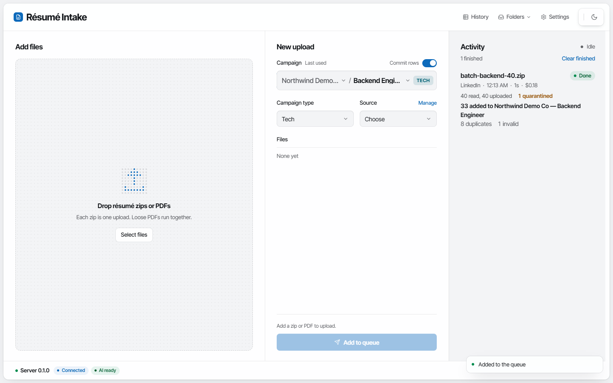

# Resume-Handler

Web page and CLI that read a batch of résumé PDFs with an LLM and turn them into candidate rows.



## What it does

- Input: PDFs or zips, by browser upload or a folder or zip passed to the CLI; zips capped at 500 entries and 500 MB unpacked
- Field extraction from PDF text, or from rendered pages for scans, through an OpenRouter-compatible model
- Name and phone normalisation; optional scoring against a job description file
- Output: a CSV, optional upload of kept files to Google Drive
- Optional commit to an ingestion API with an idempotency key per batch, so a repeated run reports duplicates
- Progress over server-sent events; 25 MB limit per uploaded file
- Offline mode: fake model, in-memory Drive and mock CRM, no keys

## Quick start

Prerequisites: Node 22 or newer. Packages install separately (different TypeScript and vitest majors); the root scripts handle that.

```bash
npm run install:all   # npm ci in every package, in dependency order
npm run build         # build the web UI into packages/web/dist
npm run demo          # fixture batch, mock CRM on :47900, server on :47831 in signed mode with the fake model
```

Open http://127.0.0.1:47831, paste the printed token, upload `demo-fixtures/batch-backend-12.zip`, pick *Backend Engineer* and run. Candidates appear on http://127.0.0.1:47900; a second run reports all duplicates. Walkthrough: [docs/DEMO.md](docs/DEMO.md).

## CLI

Run from `packages/cli` as `node bin/intake.mjs <command>`.

- `run <folder-or-zip> --campaign "Backend Engineer"`: read résumés, write a CSV, optionally commit (`--fake` for offline)
- `serve [--fake]`: start the local server and open the page
- `app [--serve]`: open the page in an Edge/Chrome app window
- `fake-llm`, `connect`: offline model endpoint; point a running server at the mock CRM and print a token
- `help [command]`: full option list

- Real model: set `INTAKE_OPENROUTER_API_KEY` for `run`, or enter the key in the page's Settings for `serve`.
- Exit codes: 0 success, 1 run failed, 2 bad usage, 3 finished but some files or the commit failed, 130 cancelled.
- Configuration: `INTAKE_*` environment variables, listed in [.env.example](.env.example) (not loaded automatically).
- Login (`INTAKE_AUTH`): `none` (loopback only, default), `token` (static bearer), `signed` (Ed25519 tokens from an external issuer, server holds only the public key).
- Secrets entered in Settings: AES-256-GCM at rest, redacted from logs and events.

## Architecture


- `packages/core`: the pipeline (safe unzip, parse, extraction, CSV, cache, Drive, scoring) plus the fake model and fake Drive
- `packages/server`: HTTP API on `node:http`, SSE, settings and secret store, auth, ingestion sink; serves the built page
- `packages/web`: Vite + React 18 page, light and dark themes
- `packages/mock-crm`: stand-in downstream system with token issuing, ingestion API and a synthetic résumé generator

Details in [docs/ARCHITECTURE.md](docs/ARCHITECTURE.md) and each package's `PORTING-NOTES.md`.

## Tests

`npm test` runs vitest in all five packages, plus one end-to-end test of the CLI against the mock CRM. Core and server output is compared with golden fixtures made by running the original Python code on synthetic inputs (`packages/{core,server}/test/golden`); deviations are listed in `PORTING-NOTES.md`. The page was also driven in Edge through Playwright against the real server in `signed` mode.

## Layout

```
packages/        core, server, web, cli, mock-crm
scripts/         run-all, demo, local start/stop
sample-resumes/  synthetic résumés and a batch zip
docs/            architecture, demo walkthrough, screenshots
```

## Limitations

- Real Google Drive is not verified end to end; Drive was exercised only through the in-memory fake.
- The model path was run by hand against OpenRouter on a few synthetic résumés, not at volume.
- PDF text comes from `unpdf` (pdf.js) and page rendering from `@napi-rs/canvas`, not PyMuPDF, so raw text length differs by a few characters from the reference; text-or-vision routing agreed on every fixture.
- The mock CRM is a demo stand-in: in-memory store, new key pair per start, open CORS, unauthenticated token endpoint. Do not expose it.
- Page history lives in the browser only (last 200 uploads); no accounts or roles.
- One run at a time per server. The scanned-style fixture PDFs use the system sans-serif font; a machine with no fonts renders blanks.
- Some golden inputs use placeholder emails on reserved or one-letter domains (for example `a@b.co`); changing them changes the golden hashes, which only the Python reference can regenerate.

## History

This project succeeds an earlier Python desktop engine. Its behaviour was checked against that engine with golden fixtures generated from the Python code, and it is now the main line.

## License

MIT, see [LICENSE](LICENSE). Contributing notes: [CONTRIBUTING.md](CONTRIBUTING.md).
