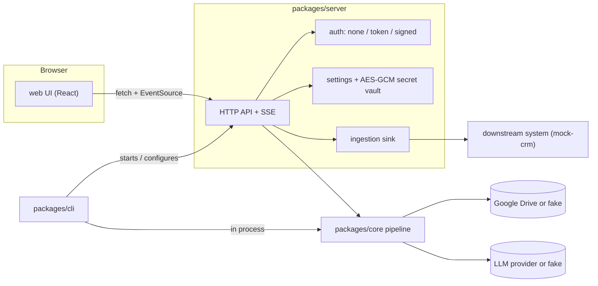
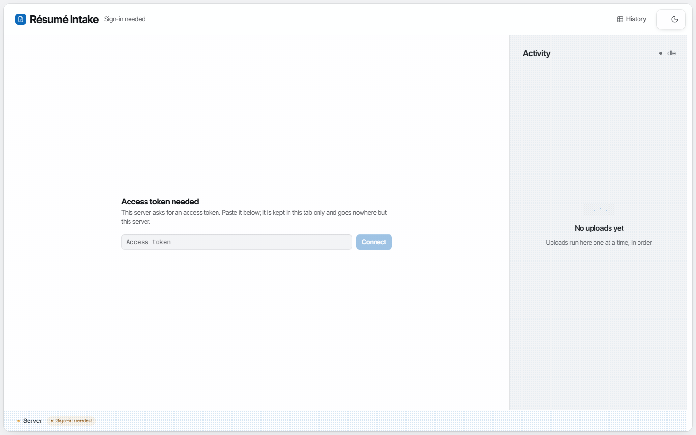
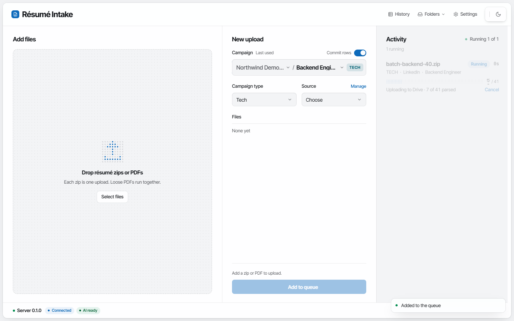
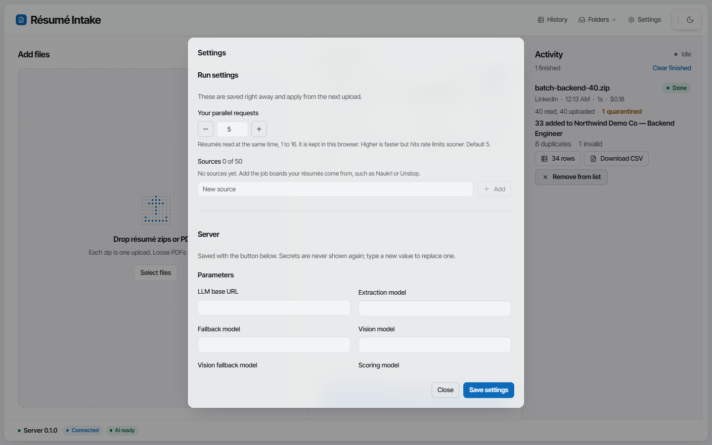
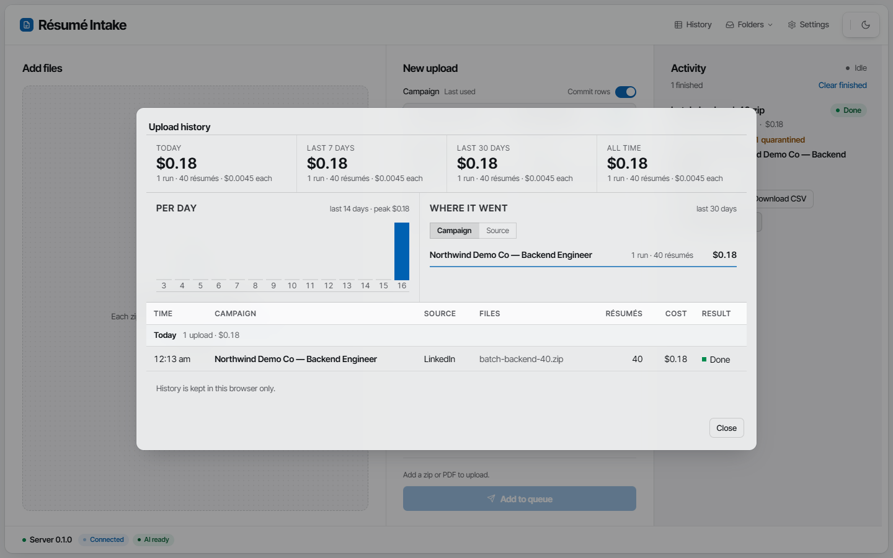
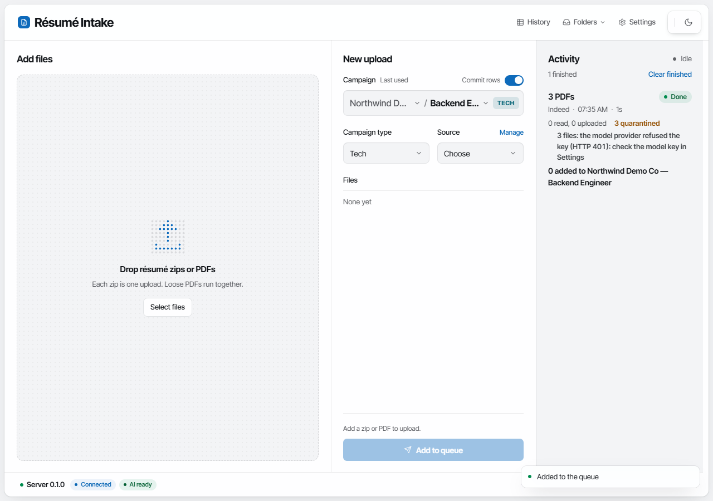
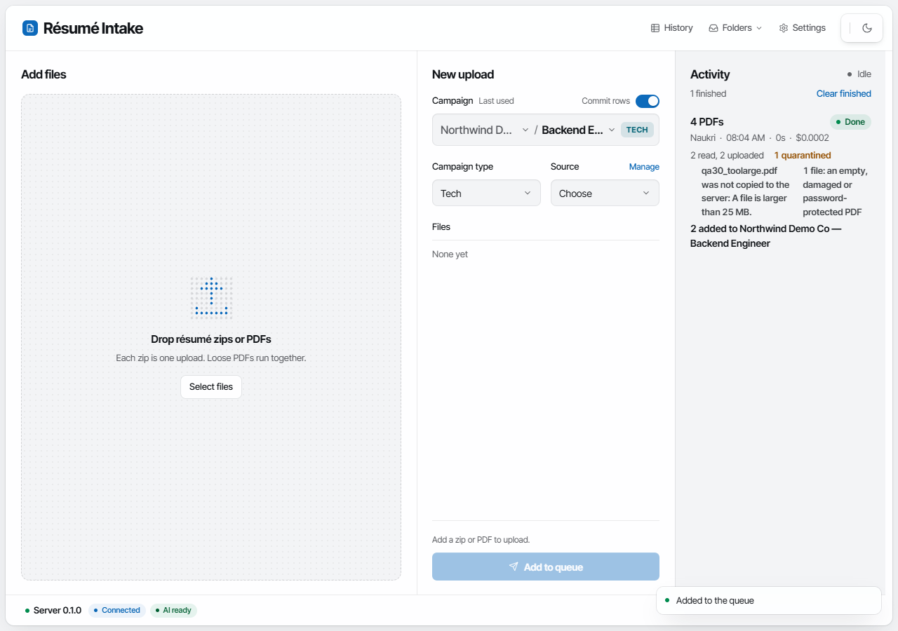
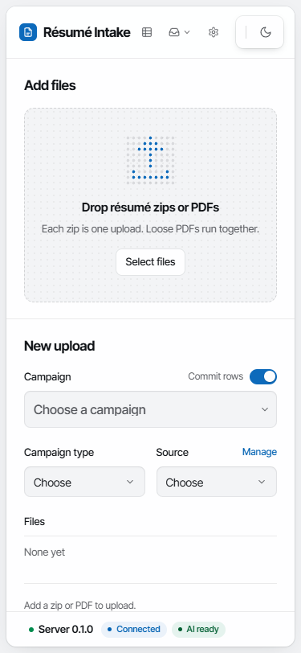

# Resume-Handler

Drop résumé PDFs or zips into a web page (or point the CLI at a folder). The tool unpacks them safely, reads each résumé with an LLM
(plain text, or vision for scans), normalises names and phone numbers, optionally scores each candidate against a job description,
optionally uploads the kept files to Google Drive, writes a CSV, and optionally commits the rows to a downstream system through an
idempotent ingestion API. Progress streams to the page live.

It is a TypeScript port of a Python desktop engine and its web page. Everything runs offline with no keys (a deterministic fake model,
an in-memory Drive and a mock downstream system are included), so you can try the whole thing in a minute.


## Architecture



| Package | What it is |
| --- | --- |
| [`packages/core`](packages/core) | The pipeline: discover, safe unzip, parse, LLM extraction, names, CSV, cache, Drive, JD scoring, events, redaction; plus the fake model and fake Drive |
| [`packages/server`](packages/server) | HTTP API on `node:http`, SSE events, settings and secret store, three auth modes, the ingestion sink, hosts the built web UI |
| [`packages/web`](packages/web) | The browser UI (Vite, React 18, TypeScript), light and dark |
| [`packages/cli`](packages/cli) | `intake run` (live terminal UI), `intake serve`, `intake app`, `intake connect`, `intake fake-llm` |
| [`packages/mock-crm`](packages/mock-crm) | A stand-in downstream system with token issuing and the ingestion API, plus a synthetic résumé generator |

More detail: [docs/ARCHITECTURE.md](docs/ARCHITECTURE.md), and a `PORTING-NOTES.md` in every package (what was ported, what was dropped and why).

## Quick start

Node 20 or newer. Each package installs on its own (no root install: they pin different TypeScript and vitest majors), so use the root scripts:

```bash
npm run install:all     # npm ci in every package, in dependency order
npm run build           # builds the web UI into packages/web/dist
npm test                # all five test suites
```

### Web, with the full offline demo

```bash
npm run demo
```

This makes a synthetic fixture batch, starts the mock CRM on port 47900, starts the server in `signed` login mode with the fake model, wires
them together, and prints the page address (`http://127.0.0.1:47831`) and a session token. Open the page, paste the token, drop
`demo-fixtures/batch-backend-12.zip`, pick the campaign *Backend Engineer* and a source, leave "Commit rows" on, and run. The candidates appear
on http://127.0.0.1:47900. Run it again and every row is reported as a duplicate. Step by step: [docs/DEMO.md](docs/DEMO.md).

| | |
| --- | --- |
|  |  |
|  |  |
|  |  |

When something goes wrong the activity entry says why, in plain words and never with file content: a refused model key (HTTP 401), unreadable or
password-protected PDFs, a PDF over the 25 MB upload limit, an input folder that was deleted, an engine that stopped mid-run (the entry ends as Failed),
or a tab closed mid-run (the server keeps going, the rows are committed and repeating the upload is safe). Cancel also aborts a model request that is
already in flight.

| | |
| --- | --- |
|  |  |
|  | |

### Web, on its own

```bash
cd packages/cli
node bin/intake.mjs serve --fake      # offline model, no login, opens the browser
node bin/intake.mjs serve             # real model: set the key in the page's Settings
```

### CLI

```bash
cd packages/cli
node bin/intake.mjs run ../../demo-fixtures/batch-backend-12.zip --fake --campaign "Backend Engineer"   # offline, live display (after `npm run demo` made the batch)
INTAKE_OPENROUTER_API_KEY=... node bin/intake.mjs run ./resumes --campaign "Backend Engineer"            # real model
node bin/intake.mjs help
```

Exit codes: 0 success, 1 run failed, 2 bad usage, 3 finished but some files or the commit failed, 130 cancelled.

### Configuration

All configuration is environment variables; see [.env.example](.env.example) for every `INTAKE_*` variable. Nothing loads that file by itself.

## Signed-session login

The server has three login modes (`INTAKE_AUTH`): `none` (loopback only, the default), `token` (one static bearer token), and `signed`.
In `signed` mode a separate issuer (the downstream system) signs short-lived session tokens and the server only holds the **public** key:

1. The issuer signs `claims` with an Ed25519 private key and hands the user `base64url(claims) . base64url(signature)`.
   Claims: `aud` (must be `resume-intake`), `role` (must be `admin`), `sub`, `iat`, `exp`.
2. The page asks for the token on first load (or reads `#token=...` from the address and removes it from the bar), keeps it in `sessionStorage`,
   sends it as `Authorization: Bearer` and as `?token=` on the event stream.
3. The server checks the signature against `INTAKE_PUBLIC_KEY` or `INTAKE_PUBLIC_KEY_FILE`, then audience, role and expiry, and applies origin
   checks. Only `GET /hello` (which tells the page which mode is on) and the static page itself are open.

Secrets entered in Settings (model key, ingestion token, Drive credentials) are stored encrypted with AES-256-GCM; the key comes from
`INTAKE_SECRETS_KEY` or a `0600` key file, and secrets are redacted from logs and events.

## How it was ported and verified

The Python original is the reference implementation. For each module, small synthetic inputs were run through the Python code to produce
**golden fixtures** (`packages/core/test/golden`, `packages/server/test/golden`, with the generator scripts alongside), and the TypeScript output is
asserted equal: default settings, prompts and request bodies, name heuristics, CSV bytes and lead ids, phone normalisation, safe-unzip limits,
settings validation, auth, ingestion idempotency keys. The relevant pytest cases of the original were ported to vitest. The result is about 1,250
tests across the five packages (core 598, server 517, cli 58, web 53, mock-crm 25), plus one end-to-end test that drives the CLI against the mock CRM. Deliberate deviations (for example the PDF
text library) are recorded in each `PORTING-NOTES.md`.

The page itself was also run in a real browser (Edge through Playwright) against the real server in `signed` mode: sign-in, upload, commit,
duplicate skipping on a re-run, cancelling a run, a failed commit followed by a retry, saving settings and reloading them, light and dark,
with no console errors.

## Limitations

- **Real Google Drive is not verified end to end.** Drive was only exercised through the in-memory fake. The model path was also run by hand against
  OpenRouter with a few synthetic résumés (that run found the placeholder-email bug fixed in `sink-commit.ts`), but not at volume; request bodies and
  flows are otherwise pinned by golden tests against the Python reference.
- PDF text comes from `unpdf` (pdf.js) and page rendering from `@napi-rs/canvas`, not PyMuPDF, so raw text length differs by a few characters
  from the reference; routing between text and vision agreed on every fixture.
- The mock CRM is a demo stand-in: in-memory store, a throwaway key pair per start, open CORS, an unauthenticated token endpoint. Do not expose it.
- The page's history is kept in the browser only (last 200 uploads); there are no accounts or roles.
- One run at a time per server. The scanned-style fixture PDFs render text with the system sans-serif font; a machine with no fonts draws blanks.
- No side-by-side visual comparison with the original web page was done (its test instance needs a sign-in this port cannot provide).
- Some golden test inputs contain placeholder email addresses on reserved or one-letter domains (for example `a@b.co`); changing them would change the
  golden hashes, which can only be regenerated with the Python reference.

## License

MIT, see [LICENSE](LICENSE). Contributing notes: [CONTRIBUTING.md](CONTRIBUTING.md).
