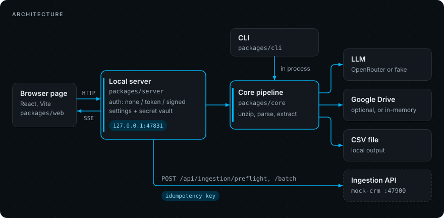
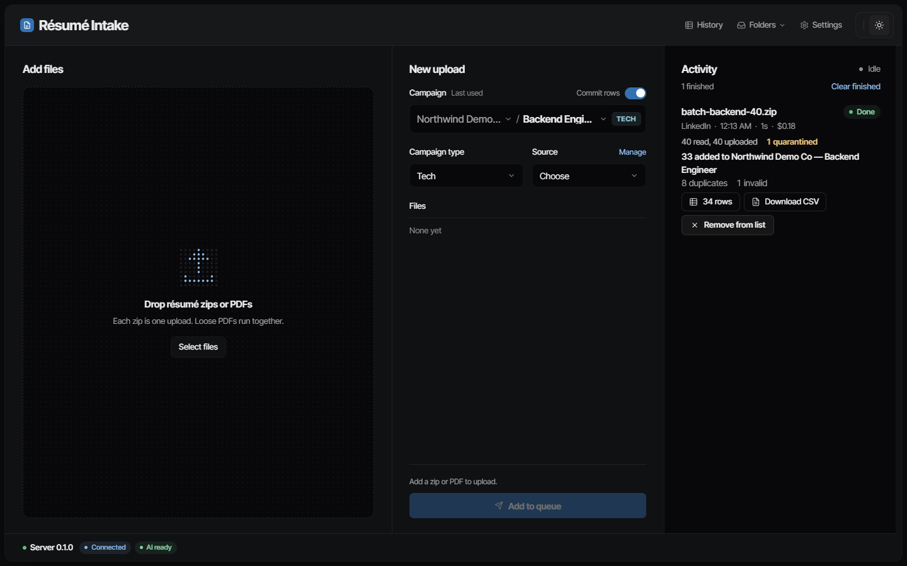
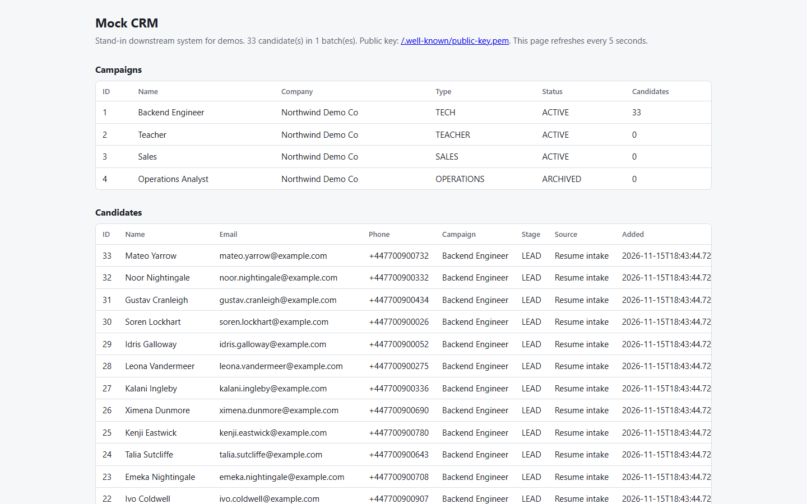

# Resume-Handler

Web page and CLI that turn a pile of résumé PDFs into candidate rows: unpack, read each résumé with an LLM, write a CSV, and optionally upload the files to Google Drive and commit the rows to a downstream system.

It is a TypeScript port of a Python desktop engine. A deterministic fake model, an in-memory Drive and a mock downstream system are included, so the whole flow runs offline with no keys.


## What it does

- Accepts PDFs or zips (browser upload, or a folder or zip given to the CLI). Zips are unpacked with size and entry limits.
- Extracts fields from the PDF text, or from rendered pages (vision) for scans, using an OpenRouter-compatible model.
- Normalises names and phone numbers, and can score each candidate against a job description.
- Writes a CSV. Optionally uploads kept files to Google Drive.
- Optionally commits rows through an ingestion API. Each batch carries an idempotency key, so repeating a run is reported as duplicates instead of creating new rows.
- Streams progress to the page over server-sent events.

## Architecture



| Package | What it is |
| --- | --- |
| [`packages/core`](packages/core) | The pipeline: discover, safe unzip, parse, LLM extraction, names, CSV, cache, Drive, JD scoring, events, redaction; plus the fake model and fake Drive |
| [`packages/server`](packages/server) | HTTP API on `node:http`, SSE events, settings and secret store, three auth modes, the ingestion sink, hosts the built web UI |
| [`packages/web`](packages/web) | The browser UI (Vite, React 18, TypeScript), light and dark |
| [`packages/cli`](packages/cli) | `intake run` (live terminal UI), `intake serve`, `intake app`, `intake connect`, `intake fake-llm` |
| [`packages/mock-crm`](packages/mock-crm) | A stand-in downstream system with token issuing and the ingestion API, plus a synthetic résumé generator |

More detail: [docs/ARCHITECTURE.md](docs/ARCHITECTURE.md), and a `PORTING-NOTES.md` in every package (what was ported, what was dropped and why).

## Quick start

Requires Node 22 or newer (CI runs 22 and 24). Each package installs on its own (no root install: they pin different TypeScript and vitest majors), so use the root scripts:

```bash
npm run install:all     # npm ci in every package, in dependency order
npm run build           # builds the web UI into packages/web/dist
npm test                # all five packages
```

### Web, with the full offline demo

```bash
npm run demo
```

This makes a synthetic fixture batch, starts the mock CRM on port 47900, starts the server in `signed` login mode with the fake model, wires
them together, and prints the page address (`http://127.0.0.1:47831`) and a session token. Open the page, paste the token, drop
`demo-fixtures/batch-backend-12.zip`, pick the campaign *Backend Engineer* and a source, leave "Commit rows" on, and run. The candidates appear
on http://127.0.0.1:47900. Run it again and every row is reported as a duplicate. Step by step: [docs/DEMO.md](docs/DEMO.md).

| | |
| --- | --- |
|  |  |
|  |  |
|  |  |

Failures are reported in the activity entry in plain words, never with file content: a refused model key, unreadable or password-protected PDFs, a file over the 25 MB upload limit, a stopped engine. Closing the tab mid-run does not stop the server, and repeating an upload is safe. Cancel also aborts an in-flight model request.

| | |
| --- | --- |
|  |  |
|  | |

### Web, on its own

```bash
cd packages/cli
node bin/intake.mjs serve --fake      # offline model, no login, opens the browser
node bin/intake.mjs serve             # real model: set the key in the page's Settings
```

### CLI

```bash
cd packages/cli
node bin/intake.mjs run ../../demo-fixtures/batch-backend-12.zip --fake --campaign "Backend Engineer"   # offline, live display (after `npm run demo` made the batch)
INTAKE_OPENROUTER_API_KEY=... node bin/intake.mjs run ./resumes --campaign "Backend Engineer"            # real model
node bin/intake.mjs help
```

Exit codes: 0 success, 1 run failed, 2 bad usage, 3 finished but some files or the commit failed, 130 cancelled.

### Configuration

All configuration is environment variables; see [.env.example](.env.example) for every `INTAKE_*` variable. Nothing loads that file by itself.

## Signed-session login

The server has three login modes (`INTAKE_AUTH`): `none` (loopback only, the default), `token` (one static bearer token), and `signed`.
In `signed` mode a separate issuer (the downstream system) signs short-lived session tokens and the server only holds the **public** key:

1. The issuer signs `claims` with an Ed25519 private key and hands the user `base64url(claims) . base64url(signature)`.
   Claims: `aud` (must be `resume-intake`), `role` (must be `admin`), `sub`, `iat`, `exp`.
2. The page asks for the token on first load (or reads `#token=...` from the address and removes it from the bar), keeps it in `sessionStorage`,
   sends it as `Authorization: Bearer` and as `?token=` on the event stream.
3. The server checks the signature against `INTAKE_PUBLIC_KEY` or `INTAKE_PUBLIC_KEY_FILE`, then audience, role and expiry, and applies origin
   checks. Only `GET /hello` (which tells the page which mode is on) and the static page itself are open.

Secrets entered in Settings (model key, ingestion token, Drive credentials) are stored encrypted with AES-256-GCM; the key comes from
`INTAKE_SECRETS_KEY` or a `0600` key file, and secrets are redacted from logs and events.

## Tests

Each package has a vitest suite (`npm test` runs all five), plus one end-to-end test that drives the CLI against the mock CRM. Core and server behaviour is checked against golden fixtures generated by running the original Python code on small synthetic inputs (`packages/core/test/golden`, `packages/server/test/golden`). The page was also run in a real browser (Edge through Playwright) against the real server in `signed` mode. Deliberate deviations from the original are listed in each package's `PORTING-NOTES.md`.

## Limitations

- **Real Google Drive is not verified end to end.** Drive was only exercised through the in-memory fake. The model path was also run by hand against
  OpenRouter with a few synthetic résumés (that run found the placeholder-email bug fixed in `sink-commit.ts`), but not at volume; request bodies and
  flows are otherwise pinned by golden tests against the Python reference.
- PDF text comes from `unpdf` (pdf.js) and page rendering from `@napi-rs/canvas`, not PyMuPDF, so raw text length differs by a few characters
  from the reference; routing between text and vision agreed on every fixture.
- The mock CRM is a demo stand-in: in-memory store, a throwaway key pair per start, open CORS, an unauthenticated token endpoint. Do not expose it.
- The page's history is kept in the browser only (last 200 uploads); there are no accounts or roles.
- One run at a time per server. The scanned-style fixture PDFs render text with the system sans-serif font; a machine with no fonts draws blanks.
- Some golden test inputs contain placeholder email addresses on reserved or one-letter domains (for example `a@b.co`); changing them would change the
  golden hashes, which can only be regenerated with the Python reference.

## License

MIT, see [LICENSE](LICENSE). Contributing notes: [CONTRIBUTING.md](CONTRIBUTING.md).
