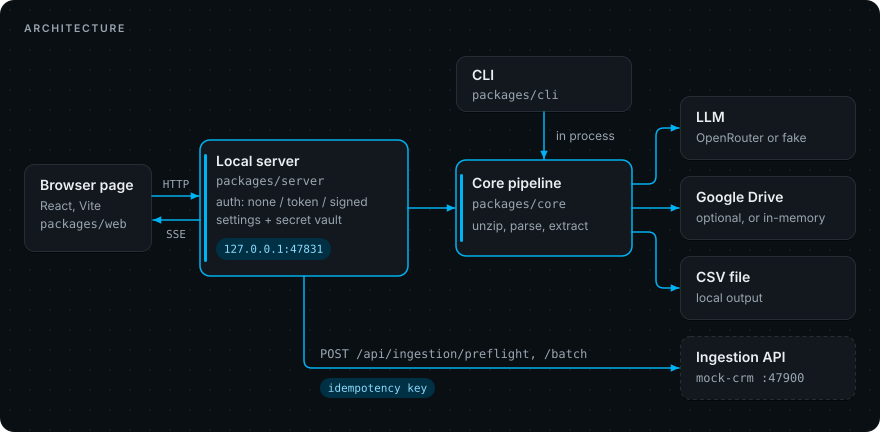

# Architecture

Resume-Handler is a TypeScript port of a Python desktop engine and its web page. An operator drops résumé PDFs or zips into the page.
The server unpacks them safely, reads each résumé (text, or vision for scans) with an LLM, normalises names and phones, optionally
scores each against a job description, optionally uploads kept files to Google Drive, writes a CSV, and optionally commits the rows
to a downstream system (the "sink") through an idempotent ingestion API. Progress streams to the page live.

## Packages

Each package is self-contained: its own `package.json`, lockfile and `node_modules`. Cross-package dependencies are `file:` links and
there is no root install (the packages pin different TypeScript and vitest majors, and two canvas builds, so one hoisted tree would not
be clean). Root scripts in `scripts/` run the packages in dependency order.

| Package | Role |
| --- | --- |
| `packages/core` | The pipeline: discover, safe unzip, parse, LLM extraction, names, CSV, cache, Drive, JD scoring, events, redaction. Also a deterministic fake LLM and an in-memory Drive for offline runs. |
| `packages/server` | HTTP API on `node:http`: routes, SSE event stream, settings and secret store, three auth modes, the ingestion sink, and static hosting of the web UI. |
| `packages/web` | The browser UI (Vite, React 18, TypeScript): upload queue, live activity, settings, local history, light and dark themes. |
| `packages/cli` | `intake run` (terminal UI), `intake serve`, `intake app`, `intake connect`, `intake fake-llm`. |
| `packages/mock-crm` | A stand-in downstream system: token issuing, `/api/ingestion/preflight` and `/batch`, a candidates page, and a synthetic résumé generator. |

## Rules shared by every package

1. TypeScript, strict mode, ESM, Node 22 or newer. Tests run with vitest, source runs with `tsx`; `core` exports `src/index.ts`.
2. Behaviour is translated faithfully from the Python reference implementation (names, defaults, limits, the error messages the UI shows,
   event shapes). Desktop-only parts were dropped on purpose; each package's `PORTING-NOTES.md` lists every drop with a reason.
3. Synthetic data only. No real names, hosts or credentials anywhere in the repository.
4. Secrets are never logged, never written to events, never committed. The redaction logic is ported as is.
5. Each module is proven against the reference: golden fixtures generated by running the Python code on small synthetic inputs, and the
   relevant pytest cases ported to vitest.

## Contract between core and server

`core` exports `runBatch(ctx)`, `RunContext`, `RunResult`, `resolveConfig(raw)`, `DEFAULTS`, `redact(text, secrets)`, the event types, and the
fake providers. `RunContext` mirrors the Python run context with camelCase fields. `RunResult` has `rows, csvPath, counts, cost, failedFiles,
cancelled, error, retryPath, runId, processed`. Events are the same JSON objects the Python emitter produced, because the web UI consumes them.

## HTTP contract between server and web

The routes and JSON shapes are those of the Python engine: `GET /hello`, `GET /state`, `GET|POST /settings`, `GET|POST /files`,
`POST /run`, `POST /cancel`, `POST /commit/retry`, `GET /events` (SSE), `GET /results`, `GET /results.csv`, `POST /open`, `POST /shutdown`.

Authentication is a mode chosen by the server's environment:

- `none`: no credentials, loopback only (default for local use).
- `token`: a static bearer token from `INTAKE_TOKEN`.
- `signed`: an Ed25519-signed session token, `base64url(claims) "." base64url(signature)`, with claims `aud`, `sub`, `role`, `iat`, `exp`.
  The server holds only the issuer's public key and checks signature, audience, role and expiry. Origin checks apply in every mode.

## Sinks

`csv` always; `ingestion` POSTs a preflight and then a batch with an idempotency key (a hash of the campaign and the sorted identities) to a
configured base URL, so repeating a run replays instead of duplicating. The mock CRM implements that API for demos and tests.
